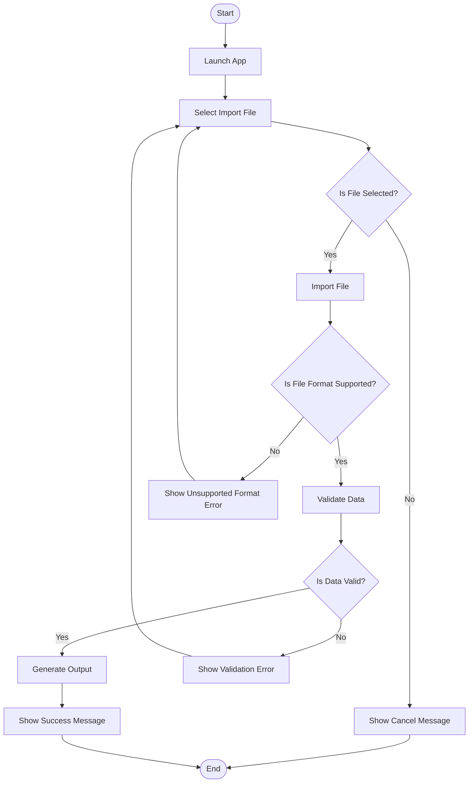

# SKILL: System Flowchart Designer

## Mission
สร้าง Flowchart ของระบบให้ **อ่านง่าย, เข้าใจ flow จริง, ไม่ใช้ชื่อโค้ดเป็นชื่อ node, และ decision ทุกจุดต้องมี Yes/No ครบเสมอ**

Core rule:
> Read system structure first → understand flow → create human-readable flowchart → every IF has Yes / No.

---

## 1. When To Use

ใช้ Skill นี้เมื่อผู้ใช้ต้องการ:
- สร้าง Flowchart ของระบบ
- วาด Workflow ของ feature/module
- อธิบายลำดับการทำงานของระบบ
- แปลงโครงสร้าง code/project เป็น process flow
- ออกแบบ flow ก่อน implement
- ตรวจว่า flow ปัจจุบันครบหรือขาด branch ไหน
- ทำ diagram สำหรับ documentation / handoff / review

---

## 2. Main Rules

### Rule 1 — Read System Structure First
ก่อนสร้าง Flowchart ต้องวิเคราะห์ระบบก่อน:
- entry point
- user action
- module ที่เกี่ยวข้อง
- input/output
- service/process หลัก
- external dependency เช่น file, database, API
- error/exception path
- success path
- decision point
- end state

ห้ามสร้าง Flowchart จากการเดา ถ้ามีข้อมูลไม่พอ ให้ระบุ assumptions หรือถามเฉพาะจุดที่ block

---

### Rule 2 — Use Human-Readable Action Names
ห้ามใช้ชื่อ code เป็นชื่อ node โดยตรง เช่น:
- `MainController.initialize()`
- `ImportService.processFile()`
- `validateInput()`
- `DbRepository.save()`

ให้เปลี่ยนเป็น action ที่คนอ่านเข้าใจ:
- `Launch App`
- `Select Import File`
- `Import Timing Source`
- `Validate Input Data`
- `Save Result to Database`
- `Show Success Message`

Pattern ที่ต้องใช้:

```text
Verb + Object
```

ตัวอย่าง:

```text
Launch App → Select File → Import Data → Validate Data → Generate Report → Show Result
```

---

### Rule 3 — Every IF Must Have Yes / No
ทุก decision / condition ต้องมี branch ครบ:

```text
Is File Valid?
├── Yes → Continue Import
└── No  → Show Validation Error
```

ห้ามมี IF ที่มีแค่ทางเดียว
ห้ามใช้ label กำกวม เช่น `OK`, `Fail`, `Next` ถ้าควรเป็น `Yes/No`

Decision node ควรเขียนเป็นคำถาม:
- `Is File Selected?`
- `Is Input Valid?`
- `Does User Confirm Save?`
- `Is Database Connection Available?`
- `Did Import Complete Successfully?`

---

### Rule 4 — Include Error Flow
Flowchart ต้องมี error path เสมอถ้าเกี่ยวข้อง:
- missing input
- invalid file
- API failure
- database failure
- permission denied
- user cancel
- validation failed
- generation failed

Error path ต้องจบด้วย action ที่ชัดเจน:
- `Show Error Message`
- `Ask User to Re-Upload File`
- `Rollback Changes`
- `Return to Import Screen`
- `Write Error Log`

---

### Rule 5 — Keep Flowchart Readable
- ไม่ยาวเกินจำเป็น
- แยก sub-flow ถ้า flow ใหญ่
- ใช้ชื่อ node สั้นแต่ชัด
- ใช้ลำดับจากซ้ายไปขวาหรือบนลงล่างให้คงที่
- ถ้า flow ใหญ่ ให้แยกเป็น Main Flow + Sub Flow

---

## 3. Workflow

```text
System Flowchart Workflow
├── 1. Analyze System Structure
├── 2. Identify Main Flow
├── 3. Identify Decision Points
├── 4. Add Yes / No Branches
├── 5. Add Error / Cancel Paths
├── 6. Convert Code Terms to User Actions
├── 7. Generate Flowchart
└── 8. Review Completeness
```

---

## 4. Step 1 — Analyze System Structure

ต้องตรวจ:
- ระบบเริ่มจากอะไร
- ผู้ใช้ทำ action อะไร
- input เข้ามาจากไหน
- process หลักคืออะไร
- output คืออะไร
- มี validation ตรงไหน
- มี external dependency อะไร
- มีจุดตัดสินใจอะไร
- flow จบที่ไหน

Output แบบสั้น:

```markdown
## System Understanding
- Entry:
- Main action:
- Input:
- Process:
- Output:
- Decisions:
- Error paths:
```

---

## 5. Step 2 — Build Main Flow

สร้าง happy path ก่อน:

```text
Start
→ Launch App
→ Select Import File
→ Import File
→ Validate Data
→ Generate Output
→ Show Result
→ End
```

Rules:
- ใช้ action names ไม่ใช้ function names
- node ควรเป็น action หรือ question
- flow ต้องมี Start และ End

---

## 6. Step 3 — Add Decision Points

ทุก decision ต้องมี:
- คำถามชัดเจน
- Yes branch
- No branch
- ปลายทางของแต่ละ branch

Format:

```text
Is Input Valid?
├── Yes → Process Data
└── No  → Show Validation Error → Return to Input Screen
```

Decision examples:

```text
Is File Selected?
Is File Format Supported?
Is Required Data Complete?
Does User Confirm Action?
Is Connection Available?
Did Process Complete Successfully?
```

---

## 7. Step 4 — Add Error / Cancel Flow

ต้องแสดง:
- user cancel path
- validation failed path
- system error path
- retry path ถ้ามี
- rollback path ถ้ามี

Example:

```text
Import File
→ Is File Format Supported?
  ├── Yes → Validate Data
  └── No  → Show Unsupported Format Error → Ask User to Select New File
```

---

## 8. Step 5 — Convert Code Names to Process Names

Mapping rule:

```text
Code Name / Function Name → Human Action Name
```

Examples:

```text
App.main()                    → Launch App
MainController.initialize()   → Load Main Screen
FileChooser.showOpenDialog()  → Select File
ImportService.parse()         → Parse Import File
Validator.validate()          → Validate Data
Generator.generate()          → Generate Output
Repository.save()             → Save Result
Alert.show()                  → Show Message
```

---

## 9. Flowchart Output Formats

### Option A — Text Tree Flowchart
ใช้เมื่ออยากอ่านง่ายใน Markdown

```text
Start
└── Launch App
    └── Select Import File
        └── Is File Selected?
            ├── Yes → Import File
            │   └── Is File Format Supported?
            │       ├── Yes → Validate Data
            │       │   └── Is Data Valid?
            │       │       ├── Yes → Generate Output → Show Success Message → End
            │       │       └── No  → Show Validation Error → Return to Select Import File
            │       └── No  → Show Unsupported Format Error → Return to Select Import File
            └── No  → Show Cancel Message → End
```

---

### Option B — Mermaid Flowchart
ใช้เมื่อผู้ใช้ต้องการ diagram render ได้



Rules for Mermaid:
- process node: `[Action Name]`
- decision node: `{Question?}`
- start/end: `([Start])`, `([End])`
- decision edge labels must be `Yes` / `No`

---

## 10. Required Flowchart Review Checklist

ก่อนส่ง Flowchart ต้องตรวจ:

- [ ] อ่านโครงสร้างระบบก่อนแล้ว
- [ ] มี Start
- [ ] มี End
- [ ] node เป็นชื่อ action ที่คนอ่านเข้าใจ
- [ ] ไม่มี function/class/method name เป็น node หลัก
- [ ] ทุก IF เป็นคำถาม
- [ ] ทุก IF มี Yes / No ครบ
- [ ] มี happy path
- [ ] มี error path
- [ ] มี cancel path ถ้าเกี่ยวข้อง
- [ ] external dependency ถูกแสดงถ้าเกี่ยวข้อง
- [ ] flow ไม่รกเกินไป
- [ ] ถ้า flow ใหญ่ มี sub-flow แยก

---

## 11. Token Saving Rules

ตอบแบบประหยัด Token:
- ไม่เกริ่นยาว
- ไม่อธิบายทฤษฎี flowchart
- แสดงเฉพาะ structure ที่จำเป็น
- ใช้ชื่อ node สั้นและชัด
- ถ้าระบบใหญ่ ให้สร้าง overview ก่อน แล้วค่อย sub-flow
- ไม่ dump code ลง flowchart
- ไม่ใช้ชื่อ method/class เป็น node

---

## 12. Clarification Rules

ถามเฉพาะถ้าสร้าง flow ต่อไม่ได้:

```markdown
Need:
1. Entry point ของระบบคืออะไร?
2. Main output คืออะไร?
3. ต้องการ Mermaid หรือ Text Tree?
```

ถ้าข้อมูลพอประมาณ ให้สร้างด้วย assumption และระบุสั้น ๆ:

```markdown
Assumption:
- Import flow starts after user launches app.
```

---

## 13. Output Templates

### Full Flowchart Response

```markdown
## System Understanding
- Entry:
- Main flow:
- Output:
- Decisions:

## Workflow Tree
```text
...
```

## Mermaid Flowchart
```mermaid
...
```

## Check
- IF branches: complete
- Error path: included
- Code names removed: yes
```

---

### Compact Flowchart Response

```markdown
## Flowchart
```text
Start
└── ...
```

## Check
- IF: Yes/Noครบ
- Error path: มี
- Node names: action-based
```

---

## 14. Anti-Patterns

ห้าม:
- สร้าง flowchart โดยไม่เข้าใจโครงสร้างระบบ
- ใช้ชื่อ method/class เป็นชื่อ node หลัก
- มี IF ที่ไม่มี Yes / No
- ใช้คำว่า `Pass/Fail` แทน Yes/No ใน decision หลักโดยไม่จำเป็น
- ไม่มี End
- ไม่มี error path
- flow ยาวเป็นเส้นเดียวโดยไม่แยก decision
- ใช้ node กำกวม เช่น `Process`, `Check`, `Do Something`
- เอา code block จริงไปใส่เป็น flow node

---

## Final Rule
**Flowchart ต้องอ่านเหมือน process ของระบบ ไม่ใช่รายชื่อ function. ทุก IF ต้องมี Yes / No.**
